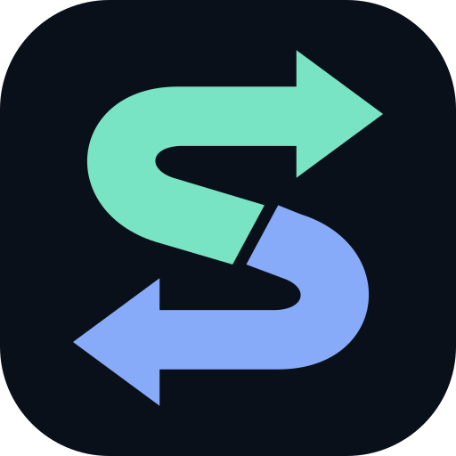

<p align="center">
  
</p>

# SkipFlow

An Android app that automatically taps an available **Skip ad** button in YouTube and YouTube Music. Built with Kotlin Multiplatform and Compose by [Ahsan Nawaz](https://ahsan2000.github.io/portfolio/).

**[Download v0.5.0 APK](https://github.com/ahsan2000/SkipFlow/releases/download/v0.5.0/SkipFlow-v0.5.0.apk)** · [All releases](https://github.com/ahsan2000/SkipFlow/releases) · [View VirusTotal report](https://www.virustotal.com/gui/file/2b866654a05901a542038fcabb595778124dab772bffbd720f3ca76ca3e44c11/detection)

Requires **Android 8.0 or newer**. Package: `com.ahsan.skipflow`.

## Before you install: scan and privacy

The published **SkipFlow-v0.5.0.apk** has a public VirusTotal report showing **0 / 67 security vendors flagged the file as malicious**, checked on **November 18, 2026**. The report's last analysis was **November 16, 2026 at 11:54:50 PKT (UTC+05:00)**. Open the [live report](https://www.virustotal.com/gui/file/2b866654a05901a542038fcabb595778124dab772bffbd720f3ca76ca3e44c11/detection) to inspect the individual results and any later updates.

- **No Internet permission:** SkipFlow processes visible player controls locally. It does not upload screen contents. The optional portfolio link opens your browser.
- **No account or analytics SDK:** settings, skip-click count and floating-icon position stay on the device. Temporary volume-recovery state is also stored locally.
- **No SMS, contacts, location or microphone permissions**, and no notification-listener access.
- **Source available for inspection:** [Android manifest](composeApp/src/androidMain/AndroidManifest.xml), [Accessibility configuration](composeApp/src/androidMain/res/xml/skip_service.xml) and [Android implementation](composeApp/src/androidMain).
- **Release signed:** public checksum and signing-certificate details are available below. Private signing keys are excluded from the repository.

A scan records what the engines detected for one specific file at a particular time. It is not a guarantee of safety or Google Play Protect approval. This result applies only to the APK with the matching SHA-256, not future builds or copies from other sources. See [Security and verification](SECURITY.md) for details.

### Why Android may show a Play Protect warning

SkipFlow needs Accessibility access to inspect visible player controls and click an available ad-skip button. This is sensitive access that you must explicitly enable. Some Android devices block Internet-sideloaded apps requesting this capability as an anti-fraud precaution; see [Google's explanation of Play Protect warnings](https://developers.google.com/android/play-protect/warning-dev-guidance).

A clean VirusTotal report does not remove that restriction. A review appeal has been submitted; its outcome has not been confirmed as of November 18, 2026. SkipFlow has not been published on Google Play. If your device blocks installation, keep its protections enabled and wait for a confirmed resolution.

## Features

- Automatically clicks the existing Skip ad control once it becomes available. It cannot skip an unskippable ad early.
- Optionally lowers detected-ad media volume to **level 1**, then restores the saved volume. Manual volume changes take priority.
- Floating **Pause / Resume** and **Home** controls, with edge docking and a faded half-hidden idle state.
- Drag directly from the docked icon. Drop it on the cross to hide it; turn Floating controls back on inside SkipFlow to restore it.
- Local skip-click counter and optional `1 + previous count = new total` celebration. Animation previews do not change the counter.

## Install and set up

1. Download the APK from the [official GitHub release](https://github.com/ahsan2000/SkipFlow/releases/tag/v0.5.0). Review the scan and verify the checksum if you can.
2. If Android permits installation, install and open SkipFlow.
3. Read the in-app disclosure, tap **Set up auto skip**, and manually enable **SkipFlow auto skip** under Android **Settings → Accessibility → Installed apps**. Samsung/Android menu names may vary.
4. Return to SkipFlow, select YouTube and/or YouTube Music, and turn **Auto skip** on. Choose whether to enable ad-volume control, floating controls and celebrations.
5. Keep the screen on and the player visible. Use Pause in the app or floating menu whenever you want to stop automation. Revoke Accessibility access in Android settings to disconnect the service.

Accessibility detection depends on the controls exposed by YouTube and YouTube Music; app updates and device layouts can affect it. Screen-off, locked-screen and cast playback are outside the verified scope. The skip count records successful click requests, not proof that content resumed. Automatic skipping in YouTube Music and ad-volume restoration were confirmed on a Samsung SM-A175F; compatibility with every device or app version is not established.

If updating from an earlier debug/test APK, the release signing key differs. Android cannot install this release over that copy. Uninstalling the old copy deletes its local settings and count.

## Verify your download

APK SHA-256 for **v0.5.0**:

```text
2b866654a05901a542038fcabb595778124dab772bffbd720f3ca76ca3e44c11
```

Compare your downloaded file with [SHA256SUMS](releases/v0.5.0/SHA256SUMS). With the APK and checksum file in the same folder, Linux users can run:

```sh
sha256sum -c SHA256SUMS
```

Expected result: `SkipFlow-v0.5.0.apk: OK`. Windows PowerShell users can run `Get-FileHash .\SkipFlow-v0.5.0.apk -Algorithm SHA256` and compare the result with the value above.

[SECURITY.md](SECURITY.md) also explains certificate verification. A matching hash proves that your file matches this scanned artifact; a signature identifies its signing key. Neither alone guarantees safety.

## Build from source

Use **JDK 21** and **Android SDK 36**, with `sdk.dir` set in your local `local.properties`:

```sh
./gradlew :composeApp:assembleDebug :composeApp:desktopTest
adb install -r composeApp/build/outputs/apk/debug/composeApp-debug.apk
```

The shared Compose UI and policy use Kotlin Multiplatform; automation uses a native Android AccessibilityService. The desktop JVM target runs shared tests. iOS and desktop automation are not implemented. See [RELEASING.md](RELEASING.md) for release packaging and [v0.5.0 release notes](releases/v0.5.0/RELEASE-NOTES.md) for changes.

## Credits

Created by [Ahsan Nawaz](https://ahsan2000.github.io/portfolio/). Logo sources are in [design](design/BRAND.md). Bundled Lato fonts include their [license](composeApp/src/androidMain/assets/licenses/Lato-OFL.txt).

SkipFlow is an independent project and is not affiliated with or endorsed by Google or YouTube.
